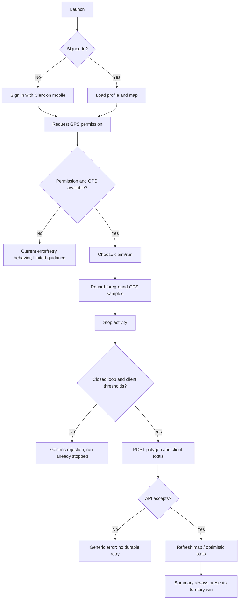

# Territory Run product and engineering audit

**Audit date:** 15 October 2026
**Scope:** Repository inspection and safe baseline checks of the current working tree. No application code was changed.
**Evidence boundary:** Findings marked *verified* come from code inspection or commands whose output was observed. Mobile runtime, backend integration, external-service behavior, production configuration, and real-device GPS were not exercised. No analytics or user research data is present. The supplied brief ends part-way through its severity definitions, so this report uses the severity levels defined in that brief (P0–P3) and its remaining unavailable instructions cannot be inferred.

## Executive assessment

Territory Run has a recognizable prototype core: a web React/Vite experience, an Expo/React Native client, an Express/Mongoose API, Clerk authentication in the mobile path, GPS tracking, loop geometry, territory polygons, and a leaderboard. The repository does not yet demonstrate a production-ready end-to-end game. In particular, claim and attack rewards are trusted from the client; the server lacks recorded-activity validation and idempotency; an attacker transfer decrements the new owner instead of the prior owner; the mobile profile URL does not match the mounted Express route; and route suggestion calls a context method that is never exposed. The web client still calls legacy authentication and map endpoints that the current server explicitly disables or does not provide.

The main user promise—go for a run, get a fair and persistent territory reward—is therefore not yet reliable or abuse-resistant. Prioritize the server authority/data-integrity defects and make one client/API path work end to end before adding AI or monetization.

## Repository and architecture inventory

| Area | Observed implementation | Status / evidence |
|---|---|---|
| Web client | React 19, Vite, React Router, Mapbox GL/react-map-gl (`src/`, `src/App.jsx`) | Builds; legacy auth/API assumptions conflict with current backend. |
| Mobile client | Expo 54, React Native 0.81, Clerk Expo, AsyncStorage, Expo Location, react-native-maps (`mobile/`) | Source exists; no mobile test/build script or device validation observed. |
| API | Express 5 in `server/index.js`; mounted auth and game routers under `/api/auth` + `/auth` and `/api/game` + `/game` | Runs only after configuration; not launched because it connects to configured Mongo and needs service credentials. |
| Persistence | MongoDB/Mongoose `User`, `Territory`, and `Team` models | User and territory schemas present; no Activity model, activity history, transaction, deletion flow, or observed migration strategy. |
| Authentication | Clerk token verification in `server/middleware/clerkAuth.js`; web still calls legacy login/register | Mixed generations; identity sync is middleware-side, with unsafe email-based account linking and uniqueness race risk. |
| GPS | Web `navigator.geolocation`; mobile `Location.watchPositionAsync` | Foreground tracking only on mobile; no accuracy/jump/gap filtering, pause/resume, durable activity lifecycle, or background task evidence. |
| Territory geometry | Client computes loop closure/area/distance; server stores client polygon and client-supplied measurements | Not server-validated; no overlap resolution or authoritative capture algorithm. |
| Map | Web Mapbox; mobile native map | Territory endpoints currently expose recent records only; UI visual behavior not inspected in a running app. |
| Leaderboard | Public top-10 user query and client display | Query exists; stats can drift and output field labels/units are inconsistent. |
| Route suggestions | Express `/suggest`, optional Google geocoding/directions; mobile screen calls it | Heuristic fallback is synthetic; mobile screen has a missing context method; suggested choice does not determine tracking route. |
| Teams | `Team` model and commented-out backend route; mobile `TeamsTab` uses hardcoded sample teams | UI-only/mock. |
| Tests | `test-loop-logic.js`, `test-attack-proximity.js`, legacy API/DB scripts | No package test script, no assertion runner, no CI config found in inspected file listing. DB script writes to configured database; intentionally not run. |
| Deployment/config | `vercel.json`, Vite proxy, app configs; no tracked env example | API rewrites exist; Vite proxy points to a fixed LAN IP; mobile production API URL is a placeholder in current working-tree edit. |

### Feature inventory

| Feature | User value | Implementation | Backend dependency | Current status | Evidence / gap |
|---|---|---|---|---|---|
| Sign-in/profile | Get a personal game identity | Clerk mobile provider + profile route | Clerk, MongoDB | **Broken / cannot verify runtime** | Mobile requests `/api/auth/profile`; router is mounted under `/api/auth` while route itself starts `/api/auth/profile`, making actual route `/api/auth/api/auth/profile`. Failure is swallowed into a perpetual loading screen. Web uses disabled legacy login/register. |
| GPS tracking | Record activity | Web and mobile hooks | Device/browser location | **Partially implemented** | Foreground location watch and local state exist. No quality filtering, background tracking, pause/resume, durable save flow, or recovery validation. |
| Loop closure / claim UX | Convert activity into territory | Client geometry + `POST /claim` | MongoDB | **Partially implemented, insecure** | Client sends polygon, area, perimeter, reward. Server stores values without validating geometry/activity. |
| Territory map | See ownership and progress | Map components + `GET /territories` | MongoDB | **Partially implemented** | Public endpoint only returns territories newer than seven days and hard-limits 1,000; durable ownership disappears from map after seven days. |
| Attacks | Compete over other players' territory | Web client proximity accumulation + `POST /attack` | MongoDB | **Broken/insecure** | Server trusts `attackDistance`; transfer writes new owner then decrements `territory.owner`, now the new owner. Mobile does not implement the attack flow. |
| Leaderboard | Social comparison | `GET /leaderboard`, mobile list | MongoDB | **Partially implemented** | Reads mutable counters; labels distance in km²; no pagination, privacy settings, season, or integrity guarantee. |
| Route suggestions | Reduce planning friction | `/suggest`, `RouteSuggestion` | Optional Google API | **Partially implemented / broken UI** | Fixed cardinal heuristic or Google directions; screen invokes missing `checkRoadStatus`; selection is not wired into run. Coordinates go to Google. |
| Teams | Group play | Team model, mobile mock screen, commented route | MongoDB | **UI-only/mock** | Hardcoded teams; API route is commented out; mobile `TeamsTab` itself is commented out in `CommandCenter`. |
| Post-run summary | Reinforce reward | `ConquestSummary` | None beyond run state | **UI-only / misleading** | Always says “NEW TERRITORY ACQUIRED”, hardcodes strength=1, and shows run state that may persist/stale; reachable after any stop. |
| AI route/reward predictions | Route discovery / strategy | No implemented model/service found | Unknown | **Not implemented** | No evidence of AI-powered recommendations, predictions, territory fortification, or activity analysis. |
| Account deletion/privacy controls | Trust and compliance | No UI or API found | Database/Clerk | **Not implemented / cannot verify** | No retention/deletion workflow or path privacy controls found. |

## User journeys and gaps

| Journey | Intended success | Actual implementation and failure conditions |
|---|---|---|
| First launch/onboarding | Explain loop capture and permissions | No explicit first-run explanation evidenced. App immediately asks location permission when token appears; permission rationale/retry UX is minimal. |
| Register/login/session restore | Authenticate and load profile | Mobile Clerk session requests a route that is double-prefixed; errors are logged but `isReady` is never set in the signed-in error case, so provider returns `null`. Web auth calls `/api/auth/login` and `/register`, both return 410. |
| Start activity | Obtain a GPS fix and visibly begin recording | Mobile watcher starts after token, regardless of active run; location samples are fed to run logic only while active. Route suggestion hits an undefined `checkRoadStatus` on mount. No explicit GPS warm-up accuracy threshold. |
| Pause/resume | Preserve time/distance without gaps | No pause/resume controls or state transitions found. |
| Track outdoors | Filter realistic GPS into trusted distance | Every sample is appended. No `coords.accuracy` validation, speed cap, gap handling, duplicate/out-of-order check. Mobile checks “on road” via reverse-geocoding every ~5 seconds/movement threshold using a source-embedded API key; this can reject parks/trails and adds latency/quota/privacy cost. |
| Background/termination/recovery | Continue safely and recover draft | Mobile uses foreground `watchPositionAsync`; active run and last position stored in AsyncStorage, but no atomic activity lifecycle or recovery UI. Web localStorage restores an active flag/path, but GPS watcher lifecycle and run mode/attack target are not restored consistently. |
| Stop/save/claim | Validate, save once, show result | Client stops local run before network response; failed claims cannot be retried from a retained draft. Server trusts all reward and geometry fields. A second tap/request has no idempotency protection. |
| View map | See persistent owned/contested territories | Server map feed filters to last 7 days, not ownership lifecycle. The web client requests `/api/game/map`, which does not exist; mobile uses `/territories`. |
| View profile/leaderboard | Accurate stats and rank | Leaderboard exists, but stats drift from attack bug, client reward input, and optimistic client changes; formatted `area` is derived from distance and has incorrect units. |
| Logout/account switch | End one identity and clear private state | Mobile delegates Clerk signout, but does not clear API default Authorization header, local run data, or in-memory profile immediately. Web clears token header/localStorage. |

**Dead ends:** web login/register and `/game/map`; mobile profile sync and route screen; mocked Teams; fake route selection; summary says success even when capture fails. The browser SPA and mobile app are separate products with divergent authentication, API contracts, game rules, and state persistence.

## Baseline commands and checks

| Command/check | Expected | Observed | Result / evidence |
|---|---|---|---|
| `npm run build` | Vite production bundle | Completed successfully; 1.68 MB Mapbox chunk (463.56 kB gzip) and chunk-size warning | **Pass with performance warning**, 13.72 sec observed. |
| `npm run lint` | No lint errors | ESLint exited 1: **78 errors, 7 warnings** across mobile/web/test files. Examples: unused variables, empty catches, React hook ordering/dependencies and purity rules. | **Fail**. |
| `node test-loop-logic.js` | Deterministic territory geometry checks | Script exited 0 but printed all four scenarios rejected, including “Valid Square” (`82.7m`, while script requires `100m`). No assertions or nonzero failure. | **Diagnostic only; not a passing test suite.** |
| `node test-attack-proximity.js` | Attack proximity behavior | Printed near/inside/outside calculations and exited 0. Does not call server or verify transfer/reward/accounting. | **Diagnostic only.** |
| `node test-api.js` | API registration probe | Immediately failed with `Unsupported protocol baseurl:` because the current edited URL begins with malformed `baseURL:` text. | **Fail, reproducible without server.** Existing user edit preserved. |
| `test-db.js` | Mongo connectivity/write probe | Not run: script writes a document to whichever `MONGODB_URI` is in local `.env`, which could be real/non-isolated data. | **Intentionally blocked for safety.** |
| `test-game-flow.js`, `test-get.js` | Legacy API checks | Not run: scripts target a fixed LAN address and legacy registration/route contracts; current server has no isolated test DB/environment. | **Blocked/unreliable.** |
| Mobile build/device run, API integration, GPS/background | Full native behavior | No simulator/device run, backend credentials, or safe isolated database available/used. | **Cannot verify.** |

Dependency install appears present (`node_modules` exists); this is not proof of lockfile health or platform compatibility. No TypeScript check or dedicated automated API/unit suite is defined in the package scripts. `.env` exists locally and is ignored; its values were not read or reported. No tracked environment example was found. The worktree had pre-existing edits at audit start in `app.json`, `mobile/App.js`, `mobile/app.json`, `mobile/src/hooks/useGameStore.js`, `mobile/src/utils/api.js`, `server/middleware/clerkAuth.js`, `server/routes/auth.js`, and `test-api.js`; all were left untouched.

## High-priority issue register

Effort: S = under a day, M = several days, L = multi-week; estimates are planning ranges, not measured. Frequency is unknown because there is no telemetry.

| ID / severity | Evidence, reproduction, impact, confidence | Recommended fix / dependencies | Acceptance and regression proof |
|---|---|---|---|
| **SEC-01 P0 — Client can mint territories and rewards** | Verified: `POST /claim` stores client `area`, `perimeter`, boundary and increments client-supplied `reward`; no run record or server derivation. Reproduce in isolated test by sending a minimal polygon and large reward after valid auth. A user can inflate claims and stats. Confidence high. | Make server derive award from a validated activity submission; validate coordinate ranges, closed ring, finite values, bounds, maximum point count, area/perimeter, GPS quality/plausibility, ownership conflicts. Add request idempotency and rate limits. M/L; define game rule first. | Reject fabricated values, malformed/oversized/self-intersecting loops and replay; duplicate same activity awards exactly once; only valid server-computed activity changes stats/map. |
| **SEC-02 P0 — Attack endpoint accepts fabricated distance** | Verified: `/attack` trusts arbitrary `attackDistance` and `territoryId`; client has no server-recorded evidence. Any authenticated caller can submit a large distance and take a territory. Confidence high. | Replace distance parameter with server-validated activity ID/path and calculate eligible engagement server-side. M/L; shared activity pipeline. | Authenticated forged/replayed attack cannot transfer ownership; a qualifying valid activity changes ownership exactly once. |
| **DATA-01 P0 — Ownership transfer corrupts counts** | Verified: line ordering sets `territory.owner = userId`, saves, increments new owner, then decrements `territory.owner` (already new owner). Repro by transfer: new owner net count unchanged; previous owner remains too high. Confidence high. | Capture prior owner before mutation and perform territory + both counters in a Mongo transaction or derive counters from authoritative records. M; Mongo replica-set transaction support. | Two-user transfer preserves total count and matches territory ownership under retries/concurrency. |
| **AUTH-01 P1 — Mobile profile endpoint double-prefixed** | Verified by Express mount + router path; request `/api/auth/profile` resolves against route `/api/auth/api/auth/profile`. Signed-in auth catch does not set readiness. User sees blank app. Confidence high; actual 404 not runtime-tested. | Define router-local `/profile`, choose one canonical prefix, set explicit error/loading state, retry safely. S. | Integration test verifies authenticated profile response on canonical URL; invalid/offline service shows actionable retry rather than blank screen. |
| **AUTH-02 P1 — Web auth is obsolete** | Verified: web hook posts legacy `/login`/`register`, server responds 410. Web routes guard solely on local token; no Clerk web provider found. Web app cannot establish a new session via current API. Confidence high. | Choose and document one auth stack/client policy; update or retire web client; remove stale endpoints only after migration. M. | Signup/login/session restore/logout test passes for supported client; protected API denies missing/expired tokens. |
| **API-01 P1 — Web map endpoint mismatch** | Verified: web `refreshMap()` requests `/api/game/map`; server offers `/territories`. Errors swallowed, leaving empty map. Confidence high. | Align versioned API contract and visible error states. S. | Contract test checks route/response shape used by each supported client. |
| **MOB-01 P1 — Route suggestion crashes on undefined context method** | Verified: `RouteSuggestion` calls `checkRoadStatus()` from mount effect; mobile provider does not export it. Confidence high from source; runtime not exercised. | Remove stale call or implement/export guarded method; avoid running reverse geocode on every GPS tick. S. | Screen opens without exception with denied/available location; loading/empty/error states render. |
| **MOB-02 P1 — Hardcoded Google API key in app source** | Verified: key literal in `mobile/src/utils/roadValidator.js`; bundled mobile code is extractable. Key not reproduced in this report. Exposure allows unauthorized quota/billing use depending on provider restrictions. Confidence high. | Revoke/rotate exposed key; restrict replacement by API, app identifier and quota; route billing-sensitive calls through server and never commit credentials. S. | Secret scan clean; old key no longer accepted; server/provider restrictions verified without disclosing value. |
| **PRIV-01 P1 — Exact GPS is sent to third party** | Verified: mobile road validator sends lat/lng in Google reverse-geocoding URL; route suggestion server also sends supplied lat/lng to Google geocoding/directions. No consent/privacy explanation found. Home/routine inference and provider retention are risks. Confidence high. | Remove per-fix lookup; request explicit, contextual consent; minimize precision and retention; offer parks/trails; review provider data terms and privacy notice. M. | No location leaves device/server absent a user action and disclosure; telemetry contains no coordinates; opt-out preserves activity functionality. |
| **GPS-01 P1 — Unfiltered GPS inflates distance/claims** | Verified: mobile adds every consecutive sample; web likewise computes distance with no accuracy/speed/gap filtering. `coords.accuracy` ignored. No replay/plausibility defense. Confidence high. | Shared deterministic GPS pipeline with accuracy thresholds, duplicate/order/gap handling, plausible-speed checks and transparent invalid-point feedback; server recomputes. M/L. | Synthetic straight/loop/noisy/jump/sparse/reordered traces meet documented expected tolerances; bad points cannot award territory. |
| **GPS-02 P1 — Activity can be lost after failure** | Verified: stop sets run inactive before request, then catch only shows generic alert; saved route remains local but no retry/recovery UI or server activity record. Confidence high. | Model an activity draft with explicit upload status, durable local queue, idempotency key, retry and delete controls. M. | Offline stop then reconnect uploads once; app restart recovers draft; user can discard; no double award. |
| **GPS-03 P1 — Background tracking is unimplemented on mobile** | Verified: foreground `watchPositionAsync`; no Expo background task configuration found. Locking/suspension can stop samples; no pause/resume. Confidence high from repository; device impact untested. | Decide whether background recording is essential; implement Expo background location task with OS permission UX, or clearly keep active screen awake and warn before suspension. M/L. | iOS/Android physical-device tests for lock, app switch, permission revoke, termination and recovery. |
| **DATA-02 P1 — Territory feed expires after seven days** | Verified: `/territories` filters timestamp greater than cutoff seven days ago. Ownership appears to expire visually without game rule or ownership transfer. Confidence high. | Define territory lifecycle; query persistent current ownership and separately model decay/rounds if intended. Add spatial viewport pagination. M. | A territory stays visible per documented lifecycle; season/reset behavior is explicit and tested. |
| **DATA-03 P1 — Claim writes are not atomic** | Verified: territory save and user-stat increment are separate operations; partial failure can desynchronize map and leaderboard. Attack similarly uses multiple writes. Confidence high. | Use transaction/outbox or derive counts from territory collection; add reconciliation job. M. | Inject failures at each write boundary and prove no partial state or eventual repair. |
| **AUTH-03 P1 — Email-based account linking is not verified safe** | Verified: middleware links a user to Clerk when token payload `email` matches; it does not establish verified-email claim or safe unique/race handling. Empty fallback emails can collide. Confidence high as code risk; real token claims depend on Clerk setup. | Link only using trusted verified identity claims or explicit account-link flow; enforce ownership/unique index behavior and handle duplicate key race. M. | Unverified/missing email cannot claim an existing account; concurrent first login creates one profile; no fabricated fallback identity collision. |
| **SEC-03 P1 — No abuse controls on public API** | Verified: wildcard CORS; no rate limiter/body-size override, pagination, request schema validator, or abuse controls observed. Claim/attack are high-value unauthenticated? They require Clerk, but valid-account abuse remains possible. Confidence high. | Restrict production origins, rate-limit sensitive endpoints, bound JSON and geometry, validate all IDs/numbers, audit suspicious award patterns. M. | Limits and validation return stable 4xx; public read endpoints have explicit privacy/capacity limits. |
| **PRIV-02 P1 — Public territory response exposes full polygons** | Verified: unauthenticated `/territories` returns every recent territory including full `boundary`, owner ref and raw `path_nodes`. Exact traces may reveal routines. Confidence high; exploitability depends on usage density. | Return minimal generalized territory shapes; omit raw path nodes and user-identifying refs; add privacy-safe visibility controls and home-area masking. M. | Anonymous response has only necessary generalized data; automated schema test prevents raw path leakage. |
| **UX-01 P1 — Claim success screen is unconditional** | Verified: summary says newly acquired territory and strength 1 without claim result; user navigates there after any stop. Confidence high. | Return structured activity outcome; summary distinguishes success, no capture, rejected, pending upload and run-only. S. | Each server result yields accurate title, reward and next action; failure never displays success. |
| **MOB-03 P1 — API base URL is not deployable** | Verified current user edit returns `https://your-production-url.com`; dev host detection may return `localhost` if Expo hostUri is absent; HTTP cleartext enabled in Android config. Mobile cannot reliably reach a deployed backend. Confidence high for placeholder, env-specific runtime untested. | Require explicit per-environment HTTPS API base URL and startup validation; remove cleartext from release builds. S. | Development on device and release config hit expected HTTPS host; build fails fast when missing config. |
| **MOB-04 P2 — Auth token preview is logged** | Verified current edit prints first 20 token characters. Partial bearer token is sensitive and can aid correlation; no reason to log it. Confidence high. | Remove token logging; scrub auth headers from diagnostics. S. | Captured logs contain no token substring or auth header. |
| **GPS-04 P2 — Road validation blocks valid activity areas** | Verified logic considers only Google `route`, `street_address`, `intersection` a valid point; parks/trails/paths may fail, and any rejected sample contributes zero distance on mobile. Not validated against actual locations. | Remove this brittle gate; rely on GPS quality and user-selected activity mode. S. | Park/trail traces remain eligible; GPS errors display accuracy, not road-name judgments. |
| **GAME-01 P2 — Capture rules are inconsistent/underspecified** | Mobile requires closure within 50m and 100m traveled perimeter; web also requires 50m, 100m and 50m² area. Mobile misses 50m² check. Backend checks none. Existing loop diagnostic reports all cases rejected. Confidence high. | Product decision on loop closure, minimum area/perimeter, holes/self-intersection, overlap, decay and contest ownership; centralize canonical rules. M. | One shared rules spec plus fixtures; client preview and server result agree for edge-case matrix. |
| **GAME-02 P2 — Overlap and concurrent claims have no resolution** | Verified: claim always inserts a new polygon; no intersection/conflict query. Two users can claim same space simultaneously. Confidence high. | Define cell/geometry ownership and tie-break policy; transactional conflict operation/spatial index. L. | Concurrent same-area submissions produce deterministic, single valid owner and consistent counters. |
| **LEAD-01 P2 — Leaderboard metric is mislabeled and stale-prone** | Verified: `area` is computed from `stats.distance / 1000` and suffixed “km²”; this is distance in km, not area. Stats are mutable counters with known reward drift. Confidence high. | Return typed fields with explicit units; derive/repair scores from authoritative activity/territory state; choose privacy and season rules. S/M. | API schema and UI units verified; totals reconcile against underlying records. |
| **UX-02 P2 — Route choices do not affect route or tracking** | Verified: cards are not selectable and Start Run always starts generic claim; `selectedRoute` exists in state but isn't used here. Confidence high. | Remove route feature until route polyline is selectable and navigation/route deviation behavior is supported, or implement that vertical slice. M. | Choosing a route changes the visible preview and recorded completion comparison; otherwise no false promise. |
| **BUILD-01 P2 — Lint is a broad release blocker** | Verified baseline `npm run lint`: 78 errors, 7 warnings, including hook use-before-declaration and many unused symbols/empty catches. Confidence high. | Split lint scopes; fix correctness findings before cosmetic cleanup; enforce in CI. M. | Clean `npm run lint` and CI gate; lint baseline exceptions explicitly documented if any. |
| **PERF-01 P2 — Large map bundle** | Verified Vite warns Mapbox chunk 1.68 MB minified / 463.56 kB gzip. First map load may be slow on mobile network. Confidence high for bundle size; user impact unmeasured. | Lazy-load map route and split vendors; measure web LCP/interaction on representative devices. S/M. | Before/after bundle and field-load metrics; no regression to map startup. |
| **OPS-01 P2 — Backend startup can appear healthy without database** | Verified server only calls `mongoose.connect` if URI exists; API listens independently in development and health returns static “Operational”. Authentication-dependent API then fails later. No DB readiness endpoint or graceful shutdown observed. | Validate required config, expose liveness/readiness separately, stop accepting traffic until database ready, graceful shutdown/timeouts. M. | Missing DB config fails clearly; health readiness tracks DB; SIGTERM drains cleanly. |
| **QA-01 P2 — No useful automated regression suite** | Verified package scripts have no test; scripts are one-off, some target obsolete URLs, outputs do not assert. Confidence high. | Add pure geometry unit suite, API integration tests with ephemeral test DB/mocks, auth boundaries, idempotency/concurrency, mobile GPS simulation; never use production DB. M/L. | CI runs deterministic isolated suite; destructive scripts require explicit test URI guard. |
| **UX-03 P3 — Error/loading/empty states are swallowed or misleading** | Verified many client catches are empty; route suggestion has `loading` but does not render loading/error; failed map refresh looks empty. Confidence high. | Add typed states and retry actions at API boundary. S/M. | Offline/timeout/empty/permission-denied states are distinguishable and actionable. |

## Territory algorithm and geospatial test matrix

**Current rule inferred from clients:** record consecutive GPS fixes and sum Haversine distance; claim mode accepts a path when the last fix is within 50 m of the first, total traveled distance is at least 100 m, and web additionally computes projected Shoelace polygon area ≥50 m². The client appends the first point to close the GeoJSON ring. Server stores client-provided ring, area, perimeter, and reward as a new territory. Attack mode in web accumulates client-side distance when fixes are within 30 m of a polygon boundary; server accepts caller-supplied attack distance against `perimeter_m * strength`.

**Assumptions and defects:** no server proof that a route was recorded; no activity ID/replay guard; client and server don't share rules; area projection assumes a small local polygon and does not reject self-crossing rings; no coordinate bounds/finite checks or ring winding/closure checks; geometry schema coordinate order differs in comments (`path_nodes` says `[lng,lat]`, callers do send that); no overlap policy; no transaction/concurrency guard. Current `strength` is set to area in m² and multiplied by perimeter in meters for attack threshold, yielding dimensionally inconsistent units.

| Trace | Expected server outcome once policy is set | Current evidence |
|---|---|---|
| Straight line / open route | No claim | Client closure check rejects unless end/start within 50m. |
| Small closed loop / below threshold | Clear minimum-distance/area rejection | Client scripts print diagnostic only; backend accepts any ≥3 point ring. |
| Valid simple closed loop | One computed claim, stable area and distance | Client submits rounded totals; backend trusts them. |
| Repeated exact path | Policy says accumulate strength or duplicate/reject | No accumulation logic found; creates another territory. |
| Parallel paths | Explicit width/area rule | No algorithm found. |
| Self-crossing bow-tie | Reject or compute defined polygon fill | No self-intersection validation. |
| Duplicate/out-of-order/noisy samples | Filter/reject deterministically | All are currently counted/appended. |
| Sparse sample/large GPS jump | Gap/speed rule | Straight-line jump credited. |
| Coordinates outside WGS84 / NaN / Infinity | 4xx, no write | Validation incomplete; Mongoose may reject some, not all. |
| Concurrent overlapping claims | Deterministic one-winner/merge rule | No conflict check or transaction. |
| Replayed claim/attack | Idempotent no-op | No activity ID or idempotency key. |
| Attack transfer | Correctly decrement prior owner once | Current transfer decrements new owner. |

## Product strategy and evidence

### Product-market-fit hypotheses

None of these can be validated from the repository; confidence below is confidence in the *hypothesis being unvalidated*, not confidence it is true.

| Hypothesis | Current evidence | Confidence | How to validate | Proposed success metric |
|---|---|---|---|---|
| Territory ownership increases recreational activity frequency | Product concept only; no analytics/research. | Low | 12–15 moderated interviews across casual runners/walkers; 2-week diary prototype pilot with consent. | Change in valid weekly activity days vs each participant's baseline; qualitative “reason to go again”. |
| Game is understandable in first minutes | Current code has no evidenced onboarding/explanation. | Low | Five first-use tasks with think-aloud; do not explain rules. | ≥4/5 correctly predict what loop earns a claim before starting. |
| Capture is rewarding enough to return | Summary currently reports false success unconditionally. | Low | Usability test of accurate reward feedback, then small cohort. | First-claim-to-next-valid-activity return rate; interview reason for return/non-return. |
| Solo users get value | Leaderboard/map exist but map sparsity and seven-day filtering undermine it. | Low | Test isolated-city/new-user scenarios using seeded synthetic map data clearly labeled. | First session comprehension and stated value without nearby opponents. |
| Loop remains interesting after novelty | No longitudinal data. | Low | 4-week diary / retention cohort after basic reliability. | W1/W4 retention and activity-days per user, segmented by first-claim status. |
| Walkers and varied fitness levels feel included | Distance thresholds/running language and GPS road gate may exclude them. | Low | Recruit walkers, occasional runners, mobility and pace variation; accessible route test. | Valid activity completion and perceived fairness by activity mode. |
| Legitimate movement beats spoofing | Current APIs accept client totals. | High confidence that current server does not establish this; actual abuse unknown. | Threat-model review and authorized synthetic request tests in isolated env. | Invalid-claim acceptance rate = 0 for specified attack fixtures. |
| Differentiation is clear versus fitness apps/territory games | Repository offers loop-drawn polygon concept; competitors have adjacent loops. | Medium-low | Concept tests with switch questions and competitor task benchmark. | Unaided positioning recall and preference for the specific loop/ownership loop. |

### Core loop assessment

| Stage | Current assessment | Friction / dropout risk |
|---|---|---|
| Discover a goal | Map and route suggestion exist, but rule/territory lifecycle is not explained. | New user cannot predict what counts; route cards do not select a route. |
| Start moving | GPS permission and tracking start exist. | Permission timing/rationale weak; missing fix accuracy and start state. |
| Record activity | Foreground raw GPS samples; no pause/background/recovery contract. | Screen lock, noisy GPS, API dependency and battery use can spoil a run. |
| Claim/expand | Client-side loop close, static thresholds; backend trusts payload. | False rejection, false rewards, overlap confusion; current algorithm doesn't implement repeated-path accumulation. |
| Feedback/reward | Alerts and summary screen. | Summary can claim success when no territory was created; no breakdown of why. |
| Track progress | Profile, map, leaderboard. | Broken endpoints, 7-day map expiration, stat drift and bad units erode trust. |
| Return | Alerts/leaderboard only; no cohort/season/social proof in working flow. | Solo map emptiness, static territory, no validated repeat motivation. |

The loop is not presently compelling enough to assess retention: correctness/trust gaps interrupt the reward promise. Fix valid claims and clear reward feedback before adding progression layers.

### Scope and prioritization

| Scope | Features |
|---|---|
| Essential core | One supported auth flow; resilient foreground activity capture; server-authoritative activity validation; clear claim rules; persistent map ownership; accurate outcome screen; privacy boundaries. |
| Trust/reliability | GPS quality filtering; offline draft/retry; idempotency; transactional counters; abuse controls; user-controlled privacy/deletion; observable API states. |
| Differentiators | Fair solo goals, map exploration, local cooperative challenges after core works. |
| Experiments | Route planning with safe/walkable options; post-run explanation; optional cosmetics. |
| Defer/remove | AI city generation, attack predictions, territory-strengthening economy, paid boosts, teams until there is a working authoritative territory lifecycle. |

RICE inputs (Reach, Impact, Confidence, Effort) are unavailable; no numerical RICE scores are defensible without user counts and engineering estimates. The issue register ranks by severity/confidence and dependencies instead. AI route generation currently solves no verified problem and has third-party location and recurring API costs; post-run analysis depends on valid stored activity data; prediction depends on sufficient territory/activity history; strengthening depends on an explicit defensible rule. All should wait for evidence.

## Competitive landscape (checked 15 Oct 2026)

| Product | Target / core loop | Territory / social / retention | Monetization / opportunity |
|---|---|---|---|
| Strava | Broad runners/cyclists; record activity, routes, segments and challenges | Segments and leaderboards; clubs/challenges; no polygon land ownership found in reviewed product materials. Official current pages describe segments and routes/challenges. | Freemium/subscription; advanced routes, insights, segment features. Territory Run must offer a playful reason beyond tracking and charts. [Features](https://www.strava.com/features), [Segments](https://support.strava.com/en-us/articles/15401945-strava-segments) |
| Turf | Location-based outdoor game; walk/cycle to real-world zone and hold it | Explicit zone capture, points, leaderboards; monthly round resets; claims worldwide zones per official site. | Official site says free to play; current exact business details not independently audited. Geography density is a differentiator and a cold-start risk. [Official Turf](https://turfgame.com/) |
| KYRO: Run & Claim Territory | Current adjacent running territory app; run loops to claim blocks, attack/defend, shared city map (App Store listing) | Very close territory-running proposition; store listing describes loop/block capture and social rivalry. | Store listing indicates free with in-app purchases; feature/pricing should be rechecked by market/store. High direct positioning overlap; Territory Run needs a distinct mechanic or audience before investment. [App Store listing](https://apps.apple.com/us/app/kyro-run-claim-territory/id6755943100?platform=ipad) |
| Territory Run (same name, unrelated listing) | App Store listing by KOSUKE OZAWA describes GPS running loops, territory, AI city generation, HealthKit, and Pro subscription | Direct name/category collision indicated by current store listing. Ownership/relationship to this repository is unknown; do not assume affiliation. | Brand/trademark/store discoverability risk; resolve naming rights and listing identity before launch. [App Store listing](https://apps.apple.com/us/app/territory-run/id6761985257) |

**Strategic implication:** Run-and-claim territory is not unique by itself in current store listings. The credible small-team edge is a fair, comprehensible, privacy-conscious loop mechanic with accurate GPS and satisfying local-map progression—not “AI” labels or more screens. A new user should have a useful solo objective even with no nearby opponents. Before launch, investigate naming rights, target-market availability, accessibility and actual competitor app behavior on both platforms; the repository audit does not prove competitor quality or audience size.

### Business viability

| Model | User value / cost | Privacy and UX risk | Recommendation |
|---|---|---|---|
| Freemium core + premium route/analysis | Could fund maps/compute if users value planning; routes and activity insights require sustained data/API costs. | Do not gate basic tracking, safety, or fair claims; route planning transmits origin/destination unless designed carefully. | Test after repeated core use is demonstrated. |
| Cosmetic themes/territory appearance | Visible self-expression; moderate design/store work, low per-user compute. | Avoid pay-to-win cosmetics that obscure territory ownership. | Plausible low-risk first paid test after retention. |
| Sponsored local challenges/events | Community value and potential partner revenue; sales/ops overhead. | Location targeting and sponsor influence can undermine trust; opt-in, aggregate-only reporting. | Small opt-in pilot with local running club/event. |
| Premium analytics | Familiar value for committed runners; requires valid history and privacy controls. | Sensitive activity histories; never sell precise route data. | Defer until data quality and deletion/export are credible. |
| Paid boosts/territory protection | Monetizable game mechanic. | Pay-to-win undermines fairness and could encourage unsafe movement. | Avoid until fairness research; likely poor fit for fitness promise. |

Validate repeat use, fair play, willingness to pay and safe route coverage before monetization investment. Do not sell precise location histories or add intrusive location ads.

## UX/design audit

No running app, simulator, or screenshots were available for visual inspection. The following are source-based findings only.

| Screen/flow | Problem and evidence | Impact / severity | Recommendation / acceptance |
|---|---|---|---|
| Auth/profile | Route mismatch and blank provider during signed-in failure. | Blocks core use, P1. | Visible load/error/retry; no blank screen. |
| Permission/GPS | Native permission request has little contextual explanation; denied status only changes GPS state. | Trust and conversion, P1/P2. | Explain why before system prompt; show settings/retry and a non-recording mode. |
| Route selection | Undefined `checkRoadStatus`, loading not rendered, cards not selectable. | Dead-end, P1. | Screen works without network; selection persists to activity or feature is removed. |
| Active run | Distance displays, stop action; no pause/resume or clear GPS accuracy quality. | Activity loss/safety, P1. | Show recording state, signal quality, elapsed time, pause/resume/discard and stop confirmation. |
| Claim outcome | Summary unconditionally announces acquired territory. | Trust damage, P1. | Render server outcome and reasons; no false positive. |
| Map | Empty and failed states indistinguishable; backend only recent 7 days; raw paths exposed. | Confusion and privacy, P1. | Explain no nearby territories, show persistent owned area, aggregate geometry. |
| Leaderboard/profile | Team scores sample/hardcoded; distance units wrong. | Misleading, P2. | Correct units, sort criteria, season, and empty state. |
| Teams | Mock content and inert create/join controls; screen commented out. | Misleading, P2. | Remove from navigation until backed by working service. |
| General accessibility | No accessibility audit/test evidence; dark neon palette may have contrast/readability issues. | Cannot verify. | Check contrast, dynamic text, labels, touch targets, color-independent ownership. |

## Architecture, reliability, performance, and security

- Keep React Native/Expo + Express/Mongoose unless later evidence shows a constraint; the current problem is divergent contracts and missing authority, not an obviously unsuitable stack.
- Centralize API schema and error mapping; separate domain validation from UI; remove duplicate web/mobile game rules or define a shared contract/fixture suite.
- Add Activity as an authoritative immutable event record, with status/quality summary and idempotency key; derive territory/stat projections or update them transactionally.
- `Territory` has a 2dsphere index and owner/timestamp index; no actual spatial query currently uses it. Current map loads up to 1,000 recent full records. Use viewport/geospatial filtering and pagination once lifecycle is defined.
- Leaderboard sorts nested stats with no matching index found in model; benchmark with isolated representative fixtures before adding indexes. No latency or capacity claims are made here.
- Mobile best-for-navigation sampling every second (`distanceInterval:0`) and road-check network work can cost battery, API quota, and latency. Measure on device only after removing per-fix third-party lookup.
- Web initial build emits Mapbox 1.68 MB minified chunk. Lazy loading is likely appropriate; measured first-load experience is not available.
- Logging currently records request URL and auth identity/email/username in middleware; request paths can include user-supplied data, and identity logs are unnecessary. Avoid logging precise coordinates, tokens, email, or full routes; use request IDs and event summaries.
- `cors({origin:'*'})`, no observed rate limit, JSON bound, or schema validation; security needs production origin policy and API limits. CORS is not authorization.
- Backend health is static while database connection is optional/asynchronous. Add readiness and graceful shutdown.
- App config enables cleartext traffic in Android; mobile production URL is a placeholder in current changes. Require HTTPS outside local development.
- `MONGODB_URI`, `CLERK_SECRET_KEY`, `GOOGLE_CONSOLE_KEY`/`VITE_GOOGLE_MAPS_API_KEY`, `VITE_MAPBOX_ACCESS_TOKEN`, and `EXPO_PUBLIC_CLERK_PUBLISHABLE_KEY` are referenced. No values were read. The Google geocoding key literal in source must be rotated/restricted.
- No dependency vulnerability scan was run; network/security audit availability is not assumed. Run `npm audit` only against the lockfiles in a planned dependency review and assess false positives and breaking upgrades.

## Metrics and privacy-conscious event plan

North-star candidate: **weekly meaningful active players** = distinct consenting users with at least one server-accepted valid activity and at least one territory progression event in a Monday–Sunday local/account week. It reflects both movement and game value, but may undercount users who value activity without a claim; compare it to weekly valid activity players and retention before adopting.

| Metric | Formula / window | Event requirements | Decision |
|---|---|---|---|
| Onboarding completion | completed first-run steps / onboarding starts; cohort day 0 | `onboarding_started`, `onboarding_completed` | Remove confusing setup steps. |
| Location permission grant | granted / permission prompt shown; first session | `permission_prompted`, `permission_result` (state only) | Improve rationale or fallback. |
| First valid activity | users with accepted activity / new signups; 7 days | `activity_started`, `activity_upload_accepted` | Diagnose setup/tracking friction. |
| Time to first claim | median time from signup to first accepted claim; cohort | server timestamps; no coordinates in analytics | Adjust first goal/onboarding. |
| Activity completion | valid uploads / started activities; weekly | start, pause/resume, stop, upload state | Locate capture/save failures. |
| Claim success | accepted claims / claim attempts; weekly | attempt outcome/reason enum | Tune rules and validation feedback. |
| WAU / meaningful WAU | distinct active / distinct meaningful; weekly | session and accepted activity + progression | Compare engagement vs product value. |
| Activities per active player | accepted activities / active users; weekly | accepted upload | Assess habit frequency. |
| W1/W4 retention | cohort users active in days 7–13 / signup cohort, days 28–34 / cohort | pseudonymous account ID, accepted activity | Assess durability. |
| Return after first claim | claimers with subsequent valid activity within 7 days / claimers | accepted claim + activity | Test reward loop. |
| GPS capture failure | activities rejected for quality/permission / starts; weekly | reason enum; no trace | Improve device support/rules. |
| Save failure | upload failures / upload attempts; daily/weekly | status, retry count | Reliability priority. |
| Invalid claim rate | rejected validation attempts / claim attempts; weekly | reason enum; server validation | Detect abuse or poor rules. |
| Crash-free sessions | non-crashed sessions / all sessions; weekly | privacy-reviewed crash SDK, no route/token payload | Release quality. |
| API latency/error | p50/p95 by route; 4xx/5xx rate, daily | request ID, route template, status, duration | Capacity and reliability. |

**Minimal schema:** `event_id`, `event_name`, timestamp, pseudonymous account ID, app version/platform, coarse locale/timezone if necessary, activity mode, outcome/reason enum, distance bucket (not exact GPS), duration bucket, GPS quality summary bucket, retry count, request ID. Keep precise trace only as an explicit activity record with informed consent, access controls, deletion/export, retention period, encryption, and optional start/end masking. Analytics must never include raw coordinates, encoded polylines, full addresses, auth tokens, email, or map screenshots.

## Validation experiments (after reliable instrumentation)

1. **Explain the loop:** New users see a 3-step visual rule explanation vs current entry. Target first-time recreational walkers/runners. Primary: correct rule prediction and first valid activity within 7 days. Guardrails: permission denial, unsafe route feedback, onboarding abandonment. Run moderated sessions first (5–8 per iteration), then a small cohort until each variant has enough task observations to expose usability failures; no statistical winner claimed from tiny samples. If rules remain misunderstood, simplify them before development.
2. **Reliable reward receipt:** Compare accurate claim-result breakdown (why claimed/rejected, area, next step) to minimal success state. Primary: subsequent valid activity within 7 days; guardrails: save failures, support reports, false-success rate (must be zero). Minimum: observe at least 10 successful and 10 unsuccessful claim journeys qualitatively; extend cohort only if event volume supports interpretation. Improve feedback if confusion remains.
3. **Solo progression:** New-user personal/weekly exploration goals vs map/leaderboard-only start. Primary: second valid activity in 7 days; guardrails: total activity duration, user-reported pressure, unsafe route complaints. Start with 8–12 usability participants; then pilot across locations with low and high nearby-player density. If only dense areas retain users, design offline/solo objectives.
4. **Walk-friendly rules:** Offer equivalent walk/run modes and park/trail-compatible GPS validation vs one generic mode. Primary: valid completion rate segmented by self-selected mode; guardrails: invalid GPS rate, drop-off, safety complaints. Recruit 8–10 walkers and 8–10 mixed-pace runners for trace/device usability; use real devices only with consent and do not encourage unsafe routes. Keep inclusive mode if failures are lower without fraud increase.
5. **Privacy explanation:** Just-in-time location purpose/retention disclosure and controls vs a concise standard explanation. Primary: informed permission completion and comprehension; guardrails: permission denial, privacy concern reports. Qualitative test with 8–10 participants before any A/B. If users cannot explain whether paths are public, redesign before launch.

## Roadmap and release gates

### P0 — Secure and make claims truthful (first)

1. Rotate/restrict the embedded Google key; remove all credentials from source and logs.
2. Stop trusting client reward, geometry measurements, and attack distance; define canonical rules and server validation.
3. Fix ownership transfer and make territory/stat updates atomic/idempotent.
4. Decide canonical API routes and supported auth client; fix profile sync and web legacy paths or explicitly remove unsupported web surfaces.
5. Correct false-success outcome and preserve failed activity drafts.

**Gate:** isolated integration tests prove forged/replayed claims and attacks do not award; valid claim/transfer updates map and both users exactly once; auth/profile works; a failed save can be retried safely.

### P1 — Trustworthy capture and privacy

1. Create authoritative activity lifecycle and synthetic GPS fixture suite.
2. Filter GPS quality/jumps/gaps; handle permission loss, app background, offline queue and restart.
3. Remove third-party reverse geocoding from each GPS tick; add consent, privacy controls, public geometry minimization, retention/deletion.
4. Fix map lifecycle (no unexplained seven-day disappearance), viewport/pagination, API errors, readiness/rate limits.
5. Remove or complete mocked teams, route selection, and misleading summary features.

**Gate:** iOS/Android device verification for screen lock, denied/revoked permission, GPS gaps, restart, offline recovery and battery sampling; API privacy/schema tests; explicit user-facing rules.

### P2 — Retention and performance

1. Add onboarding, solo goal, accurate post-run explanation, and fair local competition.
2. Add metric events per privacy schema and cohort reporting; measure W1/W4 and first-claim return before monetization.
3. Lazy-load map, benchmark representative territory viewport queries, add justified indexes and concurrency tests.
4. Evaluate premium route/analytics or cosmetics only after users return and trust is established.

**Capacity validation scenario:** In an isolated database, replay synthetic activity uploads and overlapping claims at increasing concurrency; measure p50/p95 latency, error rate, transaction conflicts, and correctness. Use 1/10/50/100 concurrent clients as test steps, not claimed product capacity; stop if database cost or fixture leakage risk appears. No load test was run in this audit.

## Business and product decisions still needed

- Is territory ownership permanent, decays, seasonal, or only map-visible for a period?
- Does capture mean closing a loop, enclosing a minimum area, mapping an H3/grid cell, or accumulating repeated paths? What are exact rules for self-crossings, overlap, boundaries and attacks?
- Is the primary audience walkers as well as runners? Is background tracking necessary for the first release?
- Which client is the launch product: mobile only, web only, or both? Current auth and APIs cannot support both consistently.
- Should exact activity paths be private by default, and what masking/retention/deletion controls are required?
- What location coverage makes the product valuable in a sparse city, and what is the solo game loop?
- Can the Territory Run name and store identity be used given a same-name App Store listing?
- What user evidence would justify route suggestions, AI analysis, teams, premium, or sponsored challenges?

## Limitations

No database/API server was started; no credentials were read; no production or remote database was contacted; no destructive operations were run. Native app visual QA, device GPS, background location, energy consumption, Clerk outage behavior, and Google/Mapbox live service behavior remain unverified. No user research, analytics, market-size, revenue, competitor usage metrics, or performance benchmark is available. Market observations above rely on current official product pages/store listings and are point-in-time, not exhaustive. The external same-name app listing does not establish any connection to this repository.
